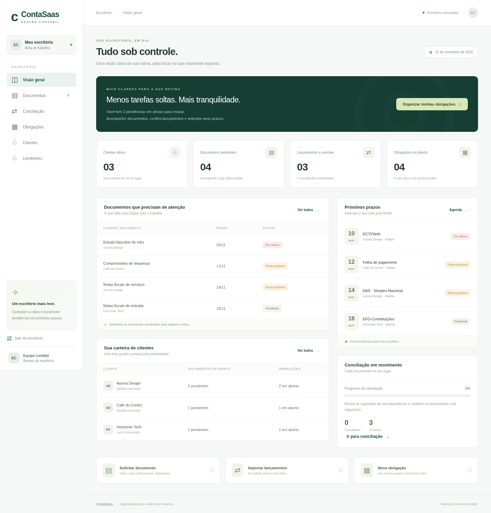
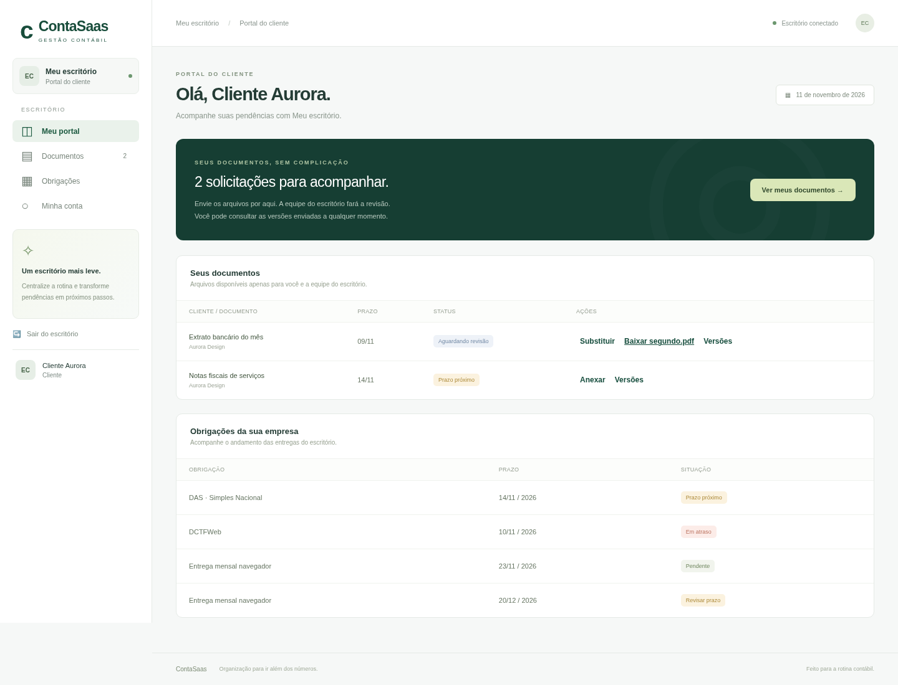

# ContaSaas

Gestão contábil em português com portal do cliente, acessos individuais, documentos versionados, conciliação e obrigações recorrentes. Python 3.12+, SQLite e JavaScript, sem dependências externas de execução.



## Funcionalidades

| Área | O que está implementado |
|---|---|
| Portal do cliente | Login individual em `/portal`, consulta das próprias solicitações/obrigações, envio e download dos próprios documentos e versões |
| Pessoas e permissões | Administrador, equipe e cliente; senha temporária com troca obrigatória; redefinição, desativação e encerramento das sessões |
| Documentos | Solicitações por prazo/cliente, anexos de até 8 MB, revisão, histórico de versões e restauração pela equipe |
| Conciliação | Importação CSV e OFX, deduplicação, regras por texto/tolerância de datas, sugestões por cliente/valor e confirmação humana reversível |
| Obrigações | Agenda, responsável, status, modelos mensais por regime tributário, geração idempotente e revisão dos prazos propostos |
| Lembretes | Antecedência/frequência configuráveis, pausa por cliente, e-mail SMTP e WhatsApp Cloud API com consentimento e template aprovado |
| Histórico | Pessoa, horário UTC, ação, recurso e detalhes permitidos; sem senhas ou conteúdo dos arquivos |
| Operação | Worker, `/health`, situação das automações no painel, backups consistentes diários, retenção e restauração com verificação de integridade |
| Escritórios | Separação por escritório em consultas e alterações; cada cliente pertence a um escritório e seu portal só vê os próprios registros |



## Iniciar

```bash
git clone https://github.com/ailtonXL/ContaSaas.git
cd ContaSaas
python3 app.py setup --username admin --office "Meu escritório"
# Opcional: somente em banco sem clientes
python3 app.py demo
python3 app.py serve --with-worker
```

Abra **http://127.0.0.1:8000**. Entre com o login escolhido e a senha definida no terminal (12 a 256 caracteres). Nenhuma senha padrão é criada. O worker integrado roda a cada 60 segundos; sem `--with-worker`, execute `python3 app.py worker` em outro processo. O worker cria recorrências e backups mesmo com os lembretes automáticos desativados.

Os envios automáticos começam **desativados**. Ative os canais em **Automações** depois de configurar as integrações no ambiente do servidor. `.env.example` documenta as variáveis; `.env` não é carregado automaticamente.

### Atualizar uma instalação anterior

Pare a versão antiga e faça uma cópia do diretório de dados antes de atualizar. O primeiro comando da versão nova migra o banco de forma aditiva: clientes, documentos, lançamentos, obrigações e anexos atuais permanecem no escritório 1. O `auth.json` antigo, quando presente e ainda não existem usuários, é convertido no usuário **admin**, com a mesma senha. As sessões antigas expiram na migração. É possível entrar imediatamente e criar os acessos individuais; o comando `setup` redefine o administrador e remove o arquivo de autenticação legado.

A migração reconhece o anexo atual de cada solicitação; arquivos substituídos na versão antiga que não tinham metadados não podem ganhar identificação retroativa. A migração é idempotente e coberta por teste. Não volte a executar a versão antiga contra o banco migrado.

### Outro escritório

O operador da instalação pode cadastrar outro escritório com administrador distinto:

```bash
python3 app.py setup --office-id 2 --office "Segundo escritório" --username segundo.admin
```

Os logins são únicos em toda a instalação. O cadastro de escritórios é feito pelo operador no terminal; um administrador de escritório não cria nem administra outros escritórios. Não há cobrança por assinatura, checkout ou provisionamento público de contas.

## Fluxos

1. Cadastre um cliente com nome, regime, identificação e e-mail.
2. Em **Acessos**, crie um usuário do perfil **Cliente**, vincule a empresa e defina uma senha temporária. Compartilhe login e senha por um canal seguro. O cliente deve trocá-la no primeiro acesso em `/portal`.
3. Crie solicitações em **Documentos**. O cliente envia o arquivo; a equipe confere e marca como concluído. Um envio passa para **Em andamento** e deixa de ser cobrado como documento faltante. A equipe pode baixar e restaurar versões anteriores.
4. Importe o extrato bancário e os lançamentos contábeis em **Conciliação**, revise as sugestões e confirme. Regras recorrentes sugerem correspondências pelo texto, cliente, valor e tolerância de data; não confirmam operações sozinhas.
5. Crie modelos em **Recorrências** por regime tributário. O worker, ou **Gerar agora**, propõe obrigações do mês atual e do próximo para os clientes daquele regime. Em **Obrigações**, revise e confirme o prazo de cada proposta.
6. Configure os lembretes em **Automações** e as autorizações/pausas na carteira de **Clientes**. Acompanhe a fila e o resultado de cada canal em **Lembretes**.

### Perfis

| Ação | Administrador | Equipe | Cliente |
|---|---|---|---|
| Consultar o escritório | Sim | Sim | Apenas seus documentos e obrigações |
| Solicitar, revisar e restaurar documentos | Sim | Sim | Enviar e baixar apenas os próprios |
| Conciliar e gerenciar regras/recorrências | Sim | Sim | Não |
| Preparar lembretes e configurar contato do cliente | Sim | Sim | Não |
| Gerenciar acessos, configurar automação e ver auditoria | Sim | Não | Não |
| Trocar a própria senha | Sim | Sim | Sim |

A desativação ou redefinição de senha encerra as sessões do usuário. A alteração da própria senha encerra as outras sessões. O administrador não pode desativar o próprio acesso pela interface. Não há recuperação de senha por e-mail: outro administrador redefine a senha, ou o operador usa `setup` para um administrador.

## Importação

### CSV

UTF-8, cabeçalho exato, delimitado por ponto e vírgula (recomendado) ou vírgula:

```csv
data;descricao;valor
2026-11-10;Recebimento cliente;1500,00
2026-11-10;Pagamento fornecedor;-250,00
```

Até 2 MB / 5.000 linhas. Datas ISO; valores em reais com até duas casas decimais; saídas negativas. Uma linha inválida cancela o lote inteiro. Reimportar o mesmo conteúdo para o mesmo cliente/origem não duplica lançamentos. Ocorrências idênticas dentro de um arquivo são preservadas; arquivos sobrepostos com repetições idênticas devem ser revisados antes de importar.

### OFX

OFX bancário XML ou SGML com blocos `<STMTTRN>...</STMTTRN>` e campos DTPOSTED, TRNAMT e FITID. A descrição usa MEMO ou NAME. Suporta UTF-8 e Windows-1252 na interface, até 2 MB e 5.000 transações. Identifica duplicatas por cliente, origem, identificação da conta e FITID; um FITID repetido com data/valor diferente rejeita o lote. Importe uma única conta identificada por ACCTID por arquivo. OFX se aplica apenas ao extrato bancário. A deduplicação é por formato/origem: não importe as mesmas movimentações primeiro em CSV e depois em OFX.

## Recorrências e prazos

Os modelos são mensais, por regime, a partir do mês informado. Dias 29, 30 e 31 são limitados ao último dia existente no mês. Cada obrigação gerada tem competência e sinalização de revisão pendente. A geração não duplica a mesma combinação modelo/cliente/competência. Pausar um modelo impede novas gerações; não exclui tarefas já criadas. Modelos criados depois de um período não preenchem todo o passado: a geração cobre somente o mês atual e o próximo.

O contador deve ajustar feriados e regras legais em **Revisar prazo**. Propostas ainda não revisadas não entram nos lembretes. O sistema não consulta Receita/SEFAZ, não calcula impostos nem transmite declarações.

## E-mail e WhatsApp

### E-mail

Configure `SMTP_HOST`, `SMTP_PORT` (587 por padrão), `SMTP_USER`, `SMTP_PASSWORD` e `SMTP_FROM`. O envio usa STARTTLS com validação de certificado.

### WhatsApp Cloud API

Configure `WHATSAPP_TOKEN`, `WHATSAPP_PHONE_ID`, `WHATSAPP_TEMPLATE`, `WHATSAPP_LANGUAGE` (padrão `pt_BR`) e `WHATSAPP_API_VERSION` (padrão `v23.0`, ajuste conforme a versão suportada pela sua conta Meta).

Use um **template aprovado pela Meta**, cujo corpo tenha dois parâmetros de texto, nesta ordem: **nome do cliente** e **resumo das pendências**. Cadastre o telefone com país e DDD e registre a autorização do cliente. O canal só entra na fila quando habilitado no escritório e autorizado para aquele cliente. Custos, aprovação do template e credenciais são gerenciados na conta do provedor.

### Agendamento e resultados

- **Automações** define quantos dias antes avisar (0 a 30) e o intervalo entre lembretes aceitos pelo provedor (1 a 30 dias).
- O worker integrado ou separado processa os envios; também é possível executar `python3 app.py remind` manualmente. Esse comando prepara/envia conforme os canais, inclusive sem ativar o modo automático; não é apenas uma prévia.
- **Preparar lembretes** na interface somente cria/atualiza a fila do escritório; não faz chamadas externas.
- A fila é atualizada antes de cada cliente; documentos já recebidos e pendências concluídas deixam de ser cobrados. Filas de dias anteriores são canceladas e substituídas pelo resumo atual, respeitando o intervalo configurado.
- Cada canal tem estado independente. Se e-mail funcionar e WhatsApp falhar, a tentativa seguinte não reenvia o e-mail. Falhas aguardam pelo menos 15 minutos antes de nova tentativa.
- “Enviado” significa aceitação SMTP/API, não entrega/leitura confirmada. Não há webhook de status de entrega.
- Um bloqueio com prazo e renovação impede workers de enviarem a mesma fila ao mesmo tempo. Interrupção após a aceitação pelo provedor e antes da gravação no banco pode causar repetição na próxima tentativa. Pausas não cancelam mensagens que já foram aceitas pelo provedor.

Nenhum envio real foi feito nos testes do projeto; os provedores são simulados nos testes automatizados.

## Backups e recuperação

`CONTASAAS_DATA` seleciona o diretório de dados (padrão `data/`). Ele guarda SQLite, anexos e backups; tudo fica fora do Git. O worker cria um ZIP por dia UTC e remove backups mais antigos que `BACKUP_RETENTION_DAYS` (padrão 30).

```bash
# Backup adicional, sem parar o aplicativo
python3 app.py backup
# Restaurar em diretório vazio, nunca sobre uma instância em execução
python3 app.py restore --file /caminho/backup.zip --destination /caminho/dados-restaurados
```

O snapshot usa a API de backup do SQLite e bloqueia gravações durante a cópia dos anexos referenciados. Inclui todas as versões de documentos, usuários, regras e histórico. A restauração valida manifesto SHA-256, caminhos, integridade do SQLite e chaves estrangeiras; encerra sessões e remove bloqueios antigos. SHA-256 detecta corrupção, não autentica a autoria do arquivo: restaure apenas backups de confiança. O restaurador aceita até 2 GB descompactados.

Após restaurar, aponte `CONTASAAS_DATA` para o novo diretório e inicie o serviço. A restauração não inicia o worker nem envia mensagens. Credenciais SMTP/Meta ficam no ambiente e precisam ser configuradas separadamente.

**Backups físicos contêm todos os escritórios**, são acessíveis apenas ao operador pelo sistema de arquivos e não têm rota de download no painel. A recuperação de uma versão de documento é feita pela equipe na própria interface. Mantenha uma cópia dos backups fora do servidor; os ZIPs locais não substituem armazenamento externo e não são criptografados pelo aplicativo.

## Operação e limites

- Exemplos de serviço com reinício automático e proxy HTTPS: `deploy/contasaas.service` e `deploy/nginx.conf.example`. Ajuste usuário do sistema, caminhos, domínio, certificados e `/etc/contasaas.env` antes de habilitar. Esses arquivos são modelos, não uma implantação já executada.
- `/health` retorna apenas a disponibilidade do processo/banco. O painel de **Automações** mostra o último ciclo do worker, falha geral e backup mais recente; falhas por provedor ficam no histórico de lembretes.
- Sessões de 8 horas, hashes scrypt, cookies HttpOnly/SameSite, CSRF, limite de tentativas de login e consultas delimitadas por escritório. Use HTTPS e `COOKIE_SECURE=1` na internet. O backend não confia em cabeçalhos de IP encaminhados; atrás de um proxy, o limite de login se aplica ao IP do proxy.
- O servidor da biblioteca padrão e o SQLite atendem a um piloto controlado. Para operação comercial de maior porte, ainda faltam teste de carga, banco/servidor dimensionados, isolamento de infraestrutura, recuperação externa, monitoramento com alertas e revisão de segurança.
- Não há assinaturas pagas, checkout, OCR, sincronização bancária, portal de pagamentos ou integração fiscal oficial.

## Testes

```bash
python3 -m unittest discover -s tests -v
node --check static/app.js
node --check static/v2.js
```

A suíte cobre compatibilidade da migração, autenticação, troca obrigatória de senha, revogação de sessões, perfis, isolamento entre clientes/escritórios, upload/download/versões, importações atômicas, OFX e duplicação, conciliação e regras, recorrências, lembretes/canais/repetição e backup/restauração.

Teste de navegador completo em servidor e banco descartáveis:

```bash
python3 -m pip install -r requirements-dev.txt
python3 -m playwright install chromium
python3 tests/browser_v2.py
```

O teste usa Chromium do sistema quando disponível e não ativa envios reais. `tests/browser_smoke.py URL` também verifica os fluxos originais em uma instância descartável existente com demonstração; leia a senha de teste da variável `TEST_PASSWORD`.
